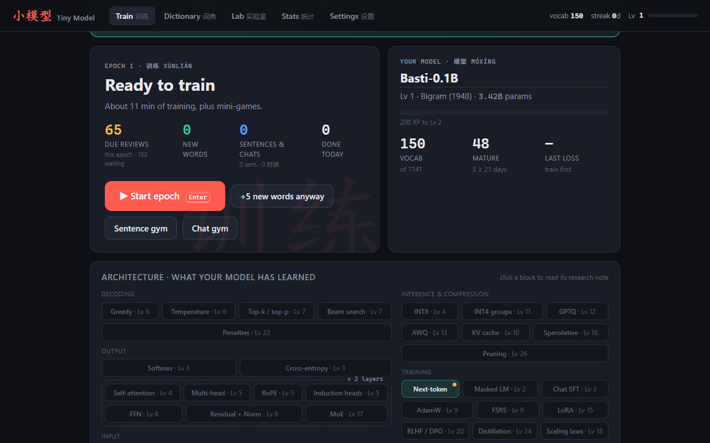
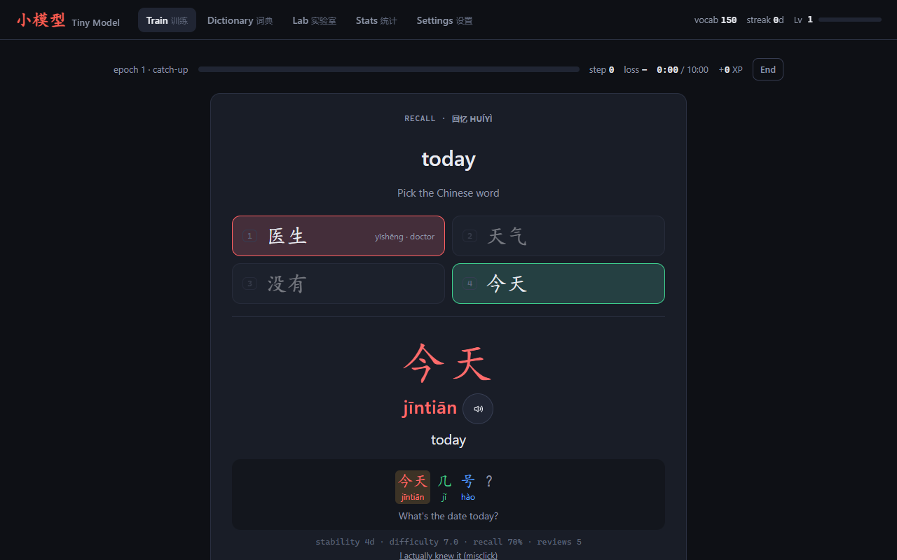
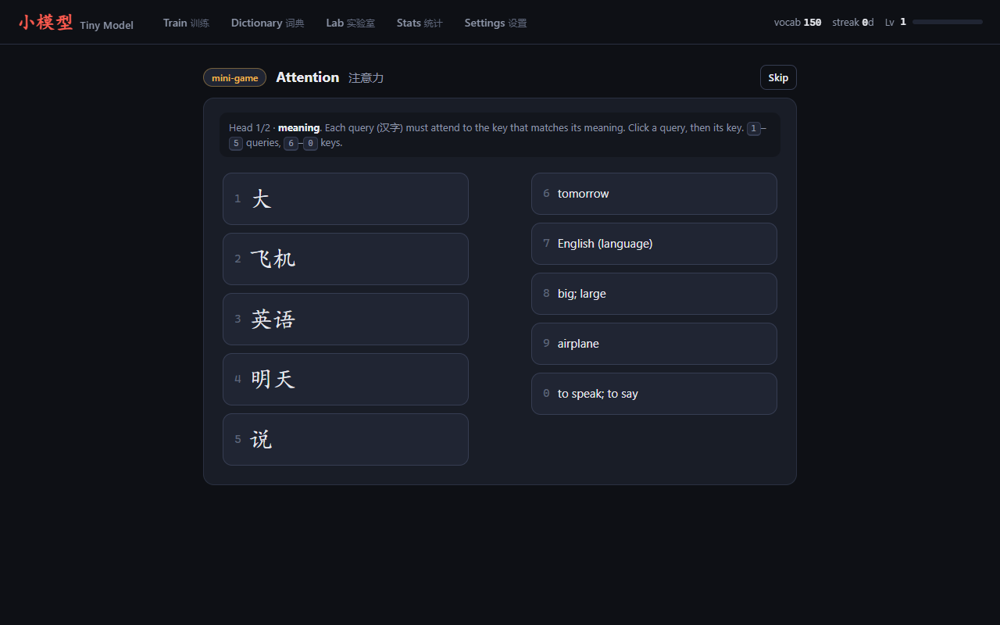
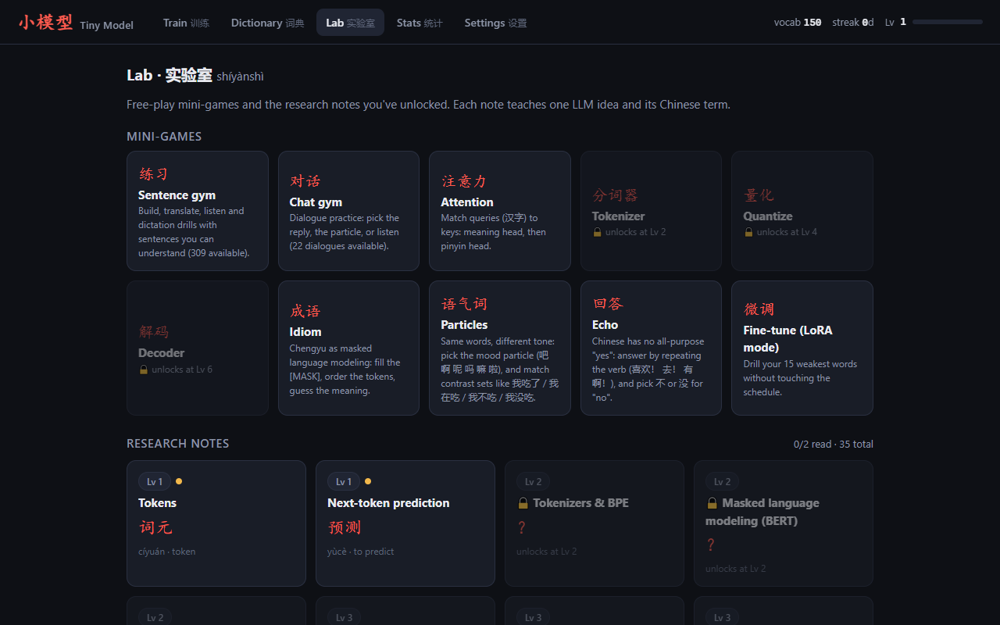

# 小模型 · Tiny Model

A single-file browser game for learning Chinese from zero, themed as "training your own LLM". Every word you learn grows your model's vocabulary, mini-games are built around real LLM ideas (attention, tokenization, quantization, masked language modeling), and research notes explain each idea together with its Chinese term.

**▶ Play it in your browser: [bastiangott.github.io/xiaomoxing](https://bastiangott.github.io/xiaomoxing/)**

  
  

  
  

I'm learning Chinese from zero and wanted something that feels like Anki but is more fun on the days I'd rather not study. I also wanted it to teach me the vocabulary of my own field, so the whole thing pretends you are training a language model.

## Play

Open the [online version](https://bastiangott.github.io/xiaomoxing/), or download `xiaomoxing.html` and double-click it. It works offline and needs no install. Microsoft Edge is the best choice because it ships natural online Chinese voices (Xiaoxiao, Yunxi). Chrome works too, using Google's 普通话 voice.

- **Daily loop:** press Enter on the dashboard to start an *epoch*: due reviews plus 10 new words, about 10 minutes. Mini-games pop up between cards.
- **Coming back after a break (catch-up mode):** new cards adapt to the review pile. Up to ~40 waiting reviews you get the full 10 new words; above that the budget shrinks, and from ~130 waiting it is review-only. Each epoch reviews at most ~65 words (scales with the epoch goal), most-forgotten first, so a pile becomes a few normal epochs. New words come back on their own as the pile shrinks, even on the same day. Inside every epoch, new words enter gradually: about a dozen reviews first, never more than 3 fresh words in learning at once, and they pause while you are forgetting a lot (held-back words just come next epoch). "+5 new words anyway" overrides it; Settings → Catch-up mode turns it off.
- **Scheduling:** FSRS-5 (the algorithm Anki offers). After each answer pick Again / Hard / Good / Easy; the buttons show the next interval.
- **Sentences:** as soon as you know every word of a sentence it can become a *sentence card* (5 new per day by default, scheduled with FSRS like words). Drills: build it from English (word tiles, or type with the Chinese keyboard / pinyin), translate it, and three listening drills with no characters on screen (pick the meaning, dictation, listen & translate). The **Sentence gym** (dashboard or Lab) is free practice that doesn't touch your schedule; *Stretch* mode gives sentences with one unknown word to guess from context.
- **Idioms (成语):** once you know 40 words, an occasional idiom card shows up (1 new every 3 days by default; Settings: off, weekly, every 3 days, daily), with literal meaning, figurative meaning and the story behind it. The **Idiom** mini-game treats chengyu as masked language modeling: fill the [MASK], put the four characters in order, pick the meaning. All 68 idioms are browsable in Lab → Idiom collection.
- **Chat fine-tuning (口语):** how people actually talk. *Chat words* (reactions like 对对对 / 好的好的 / 是的是的 / 嗯嗯 / 没事 / 算了, mood particles 啊 吧 呢 嘛 啦, fillers 那个… 就是…, slang 我去 / 牛 / 卧槽 with register labels, and key function words 也 就 还 都 又 才 再 了) arrive 3 per epoch with a usage note, and get extra reviews (scheduled for 95% retention). *Dialogue cards* (3 new per day) are short two-person chats made only of words you know: read the chat, pick the natural reply, choose the mood particle, or listen with no characters (two voices in Edge). The **Chat gym** is free practice, the **Particles** mini-game drills 吧/啊/呢/吗/嘛/啦 plus *contrast sets* (我吃了 / 我在吃 / 我不吃 / 我没吃), the **Echo** mini-game drills yes/no answers the Chinese way (repeat the verb; 不 vs 没), and Lab → Chat phrasebook lists every chat word.
- **Keys:** `1`–`4` answer and grade, `Space` accepts the suggested grade, `R` replays audio, `Esc` ends the epoch.
- **Progress** is saved in this browser's localStorage, separately for the online version and a downloaded file. Use the same browser and use Settings → Export backup now and then; Import backup restores it anywhere.

## What's inside

- ~1100 core words (HSK 2.0 levels 1–4, plus 国/德国/德语/英语 and a few other basics): a curated starter block first, then a rough frequency order. Pinyin, tone colors, meanings.
- ~1220 example sentences, word-segmented, with pinyin (不/一 tone sandhi applied) and English.
- 35 research notes on LLM internals (tokenization → attention → decoding → quantization/GPTQ/AWQ → LoRA, MoE…). They unlock by level, and each comes with its Chinese term and a quiz.
- Mini-games: Attention (matching), Tokenizer (word segmentation), Quantize (tones), Decoder (sentence building), Particles, Echo, Idiom (masked LM with chengyu, rare).
- 69 chat words in `source/data/spoken.tsv` (39 new spoken words + 30 existing particles/function words, each with a kind and a usage note), 202 dialogues in `source/data/dialogues.txt`, 46 particle items in `source/data/particles.tsv`, 12 contrast sets in `source/data/contrast.tsv`, 24 echo items in `source/data/answers.tsv`, and research notes on chat fine-tuning (SFT) and induction heads.
- 68 chengyu in `source/data/idioms.tsv` (pinyin, character-by-character gloss, meaning, origin story, some with an LLM tie-in).
- Dictionary tab with search and "Export for Anki" (a tab-separated file you can import with Anki → File → Import).

## How it's built

- **One self-contained HTML file** (about 650 KB). No server, no framework, no network calls besides the browser's own voices, so it runs offline and deploys to GitHub Pages as is.
- **Plain JavaScript modules** in `source/src` (core, UI, games, sentences, dialogues, idioms, screens) plus CSS and an HTML template. `source/build.py` inlines them together with the data into the final file.
- **A validated content pipeline.** All learning content lives in plain TSV and text files. `source/build_data.py` checks it before every build: one pinyin syllable per character, every sentence token present in the dictionary, and stable word IDs from `ids.lock.json`, so content updates never break anyone's saved progress.
- **Spaced repetition with FSRS-5**, the scheduler Anki offers, implemented in JavaScript (stability, difficulty, retrievability). Catch-up mode sits on top and turns a backlog of reviews into a few normal sessions.
- **Speech** through the browser's Web Speech API.
- **Browser tests** with Playwright in `source/test` cover the scheduler, the pinyin checker, keyboard and IME input, catch-up mode, sentence drills and the mini-games.

## Built with AI

Tiny Model was built in close collaboration with Claude (Anthropic). I set the direction from my own daily use: what to learn next, what felt overwhelming, which games were fun and which were not. Claude wrote most of the code and the learning content. One example: after a few skipped days I came back to a pile of reviews plus ten new words and it felt like too much, so we added catch-up mode. Another game turned out to be trivially easy, so it was removed.

The word list and sentences are not taken from a textbook or dictionary. If you spot a mistake, please open an issue.

## Modify

The word list and sentences were written for this project rather than imported from an external dictionary. To add or fix entries:

1. Edit `source/data/words_*.tsv` (hanzi, pinyin with tone marks, meaning, HSK level; the line order is the learning order), add new words to `source/data/words_extra.tsv` (5th column `after:<hanzi>` places them in the learning order), or add sentences to `source/data/sentences*.txt` (space-separated tokens | English).
   Chat words go in `source/data/spoken.tsv` (line order = the order they arrive; `-` in the pinyin column marks an existing word), dialogues in `source/data/dialogues.txt` (`== category`, then `A:` / `B:` turns, tokens separated by spaces), particle drills in `source/data/particles.tsv`.
   Word IDs are locked in `source/data/ids.lock.json` so saved progress always maps to the same words: keep that file.
2. Run `python source/build.py`. It checks that every pinyin has one syllable per character and that every sentence token exists in the dictionary, then writes `source/dist/xiaomoxing.html`.
3. Copy that file over `xiaomoxing.html`. Progress is kept, because it lives in the browser and not in the file.

Tests (`source/test/*.mjs`) use Playwright: run `npm install playwright` and `npx playwright install chromium` once, then `node source/test/unit.mjs` after a build.

## License

[MIT](LICENSE)
